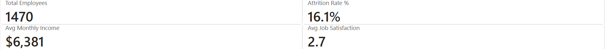
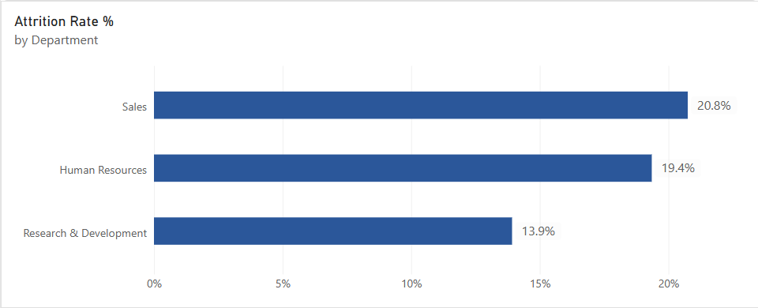
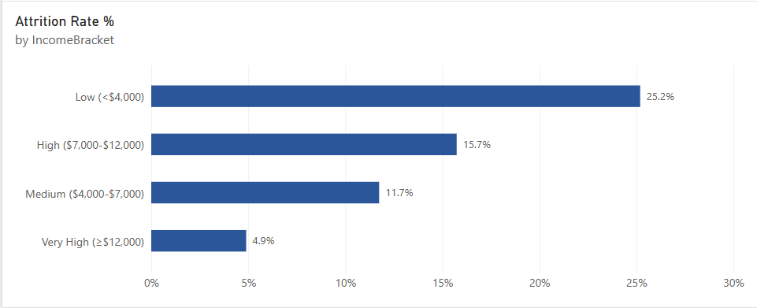
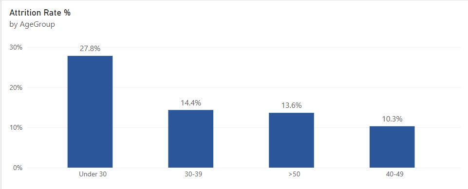
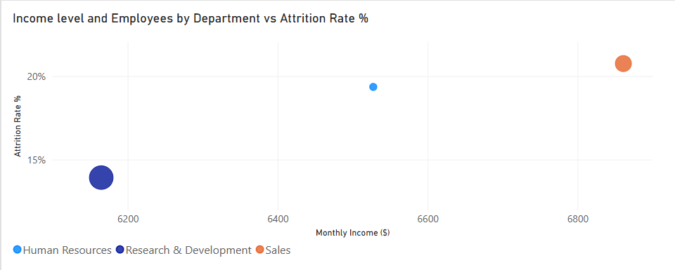
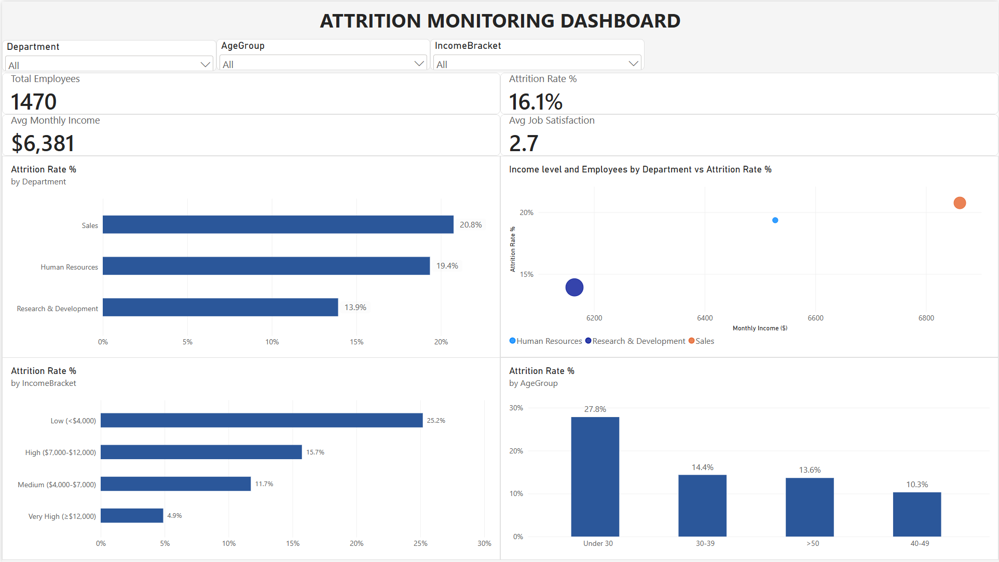

# Power BI Attrition Monitoring Dashboard

## Executive Summary

This project transforms Python EDA insights into an interactive Power BI dashboard for HR leadership. The dashboard monitors employee attrition patterns with focus on department-level performance, compensation thresholds, and engagement correlations.

**Key Insight:** The dashboard enables HR to identify at-risk employee segments and prioritize retention interventions based on data-driven thresholds.

**Status:** 🟢 **COMPLETE**  
**Project Timeline:** October 5-9, 2026 (5 days, ~10-12 hours)

---

## Business Questions Addressed

| Question | Why It Matters | How Dashboard Answers It |
|----------|---------------|--------------------------|
| What is our overall attrition rate? | Baseline retention health | KPI cards show 16.1% rate |
| Which departments have highest turnover? | Target intervention efforts | Department bar chart (Sales: 20.8%) |
| Does income predict attrition risk? | Compensate strategically | Income bracket chart (5x gap: $4k vs $12k) |
| Are younger employees at higher risk? | Design early-career programs | Age group chart (27.8% under 30) |
| Does culture outweigh income? | Holistic retention strategy | Scatter plot (R&D vs Sales paradox) |

---

## Dataset & Integration

- **Source:** IBM HR Analytics Employee Attrition & Performance
- **Integration:** Extends Project 2 (Python EDA) cleaned dataset
- **Records:** 1,470 employees after cleaning
- **Link to Project 2:** [project-2-python](../project-2-python)

### Data Quality (Inherited from Project 2)
- Missing value imputation (median/mode)
- Duplicate removal (exact + partial)
- Outlier capping using IQR method
- Category standardization to Title Case

---

## Project Structure
- project-3-powerbi/
  - .gitignore
  - LICENSE
  - README.md
  - reports/
    - 01_attrition_dashboard.pbix (main Power BI report)
  - data/
    - processed/
      - IBM_HR_Employee_Attrition_CLEAN.csv (imported from Project 2)
  - src/
    - dax_measures.txt (DAX documentation)
    - power_query_steps.md (transformations log)
  - outputs/ (exported screenshots)
    - 01_executive_summary_card.png
    - 02_department_comparison_bar.png
    - 03_income_bracket_analysis.png
    - 04_age_distribution_bar.png
    - 05_scatter_department_income.png
    - 06_full_dashboard_view.png

---

## Technical Implementation

### Dashboard Features

| Feature | Description | Visual Element |
|---------|-------------|----------------|
| **Interactive Slicers** | Filter by department, age group, income bracket | Dropdowns (3 filters) |
| **KPI Cards** | Instant overview of workforce metrics | Top panel (4 cards) |
| **Department Comparison** | Attrition rate by department | Horizontal bar chart |
| **Income Bracket Analysis** | Compensation threshold effects | Horizontal bar chart |
| **Age Distribution** | Demographic breakdown | Horizontal bar chart |
| **Department Income vs Attrition** | Attrition vs pay correlation | Scatter plot |

**Note:** Time-series trend analysis omitted due to lack of date column in dataset.

### Power Query Transformations

1. Import cleaned CSV from Project 2
2. Create `AgeGroup` column (4 age categories via UI)
3. Create `IncomeBracket` column (4 income categories via UI)
4. Skip unnecessary columns (index, binary attrition flag)
5. Validate data types (categorical fields as Text)

### Design Decisions
| Decision | Choice | Rationale |
|----------|--------|-----------|
| Add Employee ID index? | SKIP | EmployeeNumber already unique |
| Add AttritionFlag binary? | SKIP | Text "Yes"/"No" works in DAX |
| Create date table? | SKIP | No temporal data in source |
| Build star schema? | SKIP | n=1,470 from single flat source; star schema deferred until multi-table scaling required |

**Documentation:** [power_query_steps.md](src/power_query_steps.md)

---

## DAX Measures Implemented

### Core KPIs
| Measure | Formula Pattern | Result |
|---------|-----------------|--------|
| Total Employees | `COUNTROWS(Employees)` | 1,470 |
| Attrition Count | `CALCULATE([Total], Attrition="Yes")` | 237 |
| Attrition Rate % | `DIVIDE([Count], [Total])` | 16.1% |
| Avg Monthly Income | `AVERAGE(MonthlyIncome)` | $6,504 |
| Avg Job Satisfaction | `AVERAGE(JobSatisfaction)` | 2.6 |

### Advanced Calculations
| Measure | Formula Pattern | Use Case |
|---------|-----------------|----------|
| Headcount by Dept | `CALCULATE(..., ALLEXCEPT(...))` | Department breakdowns |
| Avg Income by Bracket | `CALCULATE(..., ALLEXCEPT(...))` | Income threshold analysis |

**Full Documentation:** [dax_measures.txt](src/dax_measures.txt)

---

## Key Insights Validated Across Projects

### Insight 1: Income Threshold Determines Retention Risk
- Employees earning < $4,000/month: **25.2% attrition rate**
- Employees earning ≥ $12,000/month: **4.9% attrition rate**
- **Gap:** 5x difference in turnover risk
- **Recommendation:** Review compensation structure for low-income roles

### Insight 2: Early Career Needs Targeted Support
- Employees under 30: **27.8% attrition rate**
- Employees aged 40-49: **10.3% attrition rate**
- **Gap:** 2.7x difference in turnover risk
- **Recommendation:** Implement mentorship programs for new hires

### Insight 3: Average Income Does Not Explain Department-Level Attrition
- While low monthly income is a strong individual-level attrition predictor (25.2% below the income threshold vs. 4.9% above), this relationship inverts at the department level.
- R&D reports the lowest average monthly income but the lowest attrition rate (X%), while Sales reports among the highest average
income but the highest attrition (20.8%). This suggests department-level factors — not visible directly in this dataset — outweigh average pay in explaining department retention differences.
- Candidate mechanisms would require additional data (e.g., exit interviews, workload metrics) to test.

---

## Dashboard Screenshots

### Executive Summary Card

### Department Comparison

### Income Bracket Analysis

### Age Distribution

### Department Income vs Attrition

### Full Dashboard View

---

## Tools & Environment

- **Platform:** Power BI Desktop Free Edition
- **Languages:** DAX (Data Analysis Expressions), M (Power Query)
- **Environment:** Windows 11, Git/GitHub, VS Code
- **Development Support:** AI-assisted coding and documentation review

---

## Limitations & Future Work

### Current Constraints (Free Edition)
- Dashboard cannot be published to Power BI Service (cloud)
- Sharing requires manual distribution of .pbix file
- No scheduled refresh capability
- Screenshot exports used for GitHub documentation

### Planned Enhancements (Not Implemented)
| Enhancement | Priority | Effort | Rationale |
|-------------|----------|--------|-----------|
| Add Job Role breakdown | Low | 1 day | 9 job titles could add granularity |
| Add Tenure analysis | Medium | 1 day | Years at company predicts attrition |
| Predictive attrition score | High | 3 days | Machine learning integration |
| Publish to Power BI Service | N/A | Requires Pro license | Live sharing capability |

**Note:** Current scope chosen to maintain focus on core business questions within 2-week timeline.

---

## Contact
- **Author:** JosteinCT
- **GitHub:** [github.com/JosteinCT](https://github.com/JosteinCT)
- **Email:** [josteinct@gmail.com](mailto:josteinct@gmail.com)

---

*This project was developed using AI-assisted code validation and documentation review. All analytical decisions and business interpretations are the author's own work.*

*Last Updated: October 12, 2026*

## License

MIT License — See [LICENSE](LICENSE] file

## Attribution

Dataset source: [Kaggle - IBM HR Analytics Employee Attrition & Performance Dataset](https://www.kaggle.com/datasets/pavansubhasht/ibm-hr-analytics-attrition-dataset)